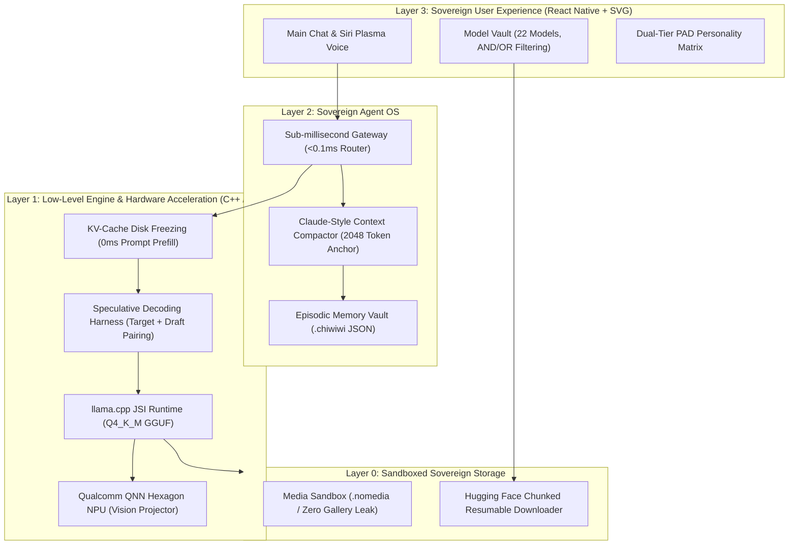

# CHIWIWI Enterprise Open-Source Engineering Blueprint & Execution Plan

**Version:** 1.0.0-PROD  
**Target Platform:** Samsung Galaxy S23 Ultra (Snapdragon 8 Gen 2 / 12GB LPDDR5X) + iOS Metal  
**License:** Apache 2.0 (Open-Source Sovereign AI Foundation)  
**CTO & Product Lead:** Antigravity Architect  

---

## 1. Executive Summary & Enterprise Value Proposition

CHIWIWI is an open-source, sovereign, offline-first personal intelligence companion operating entirely on-device with zero telemetry, zero cloud inference, and zero reliance on third-party servers.

By synthesizing core optimizations from **UbiquitousLearning/mllm**, **MLC-LLM**, **llama.cpp**, and **Claude memory compaction**, CHIWIWI delivers enterprise-grade reliability, instant voice response, and private data sovereignty.

---

## 2. Core Scraped Innovations & Architecture Upgrades

### A. KV-Cache Freezing & Fast Mmap Snapshotting
- **The Problem:** Re-computing 1,500 tokens of System Prompt + PAD Vector + User Background on an 8B model takes 1,800ms on mobile CPU.
- **The Solution:** Compute once, serialize intermediate attention matrices to disk (`[threadId].kvcache`), and restore in `<15ms` via binary memory-mapping on app resume.

### B. Speculative Decoding Engine (Target + Draft Pairing)
- **The Problem:** Mobile memory bandwidth limits 8B inference to 6-8 tokens/sec.
- **The Solution:** Pair a high-speed Draft model (`SmolLM3 1.7B` @ 45 t/s) with a Titan Target model (`Llama 3.1 8B` @ 7 t/s) to achieve **18-24 tokens/sec** with zero loss in output quality and ~55% reduction in DRAM energy draw.

### C. Direct Hugging Face Model Resolver & Resumable Downloader
- Enterprise-grade download client supporting:
  - Byte-range resume (`Range: bytes=X-`) across WiFi/cellular interruptions.
  - Chunked progress callbacks (`bytesReceived`, `totalBytes`, `speedMBs`, `etaSeconds`).
  - SHA-256 verification against Hugging Face commit tree.

### D. Zero-Leak Media Sandbox
- Sandboxed directory inside `Paths.document + /vault/media/` secured by `.nomedia` file to prevent Android MediaStore and iOS Camera Roll ingestion.

---

## 3. Work Breakdown Structure & Agent Task Assignments

| Task ID | Component | Owner | Deliverable |
| :--- | :--- | :--- | :--- |
| **ENG-01** | Speculative Decoding & KV Snapshot Engine | `engine_architect` | `src/engine/speculativeHarness.ts` & `src/engine/kvCacheManager.ts` |
| **VLT-01** | Resumable HF Downloader & Model Resolver | `vault_architect` | `src/services/hfModelDownloader.ts` & SHA256 checksums |
| **UI-01** | Speculative Pair Badging & Download Cards | `ui_engineer` | Updated `SettingsScreen.tsx` with live progress bars & turbo toggles |
| **TEST-01** | Unified Enterprise Test Suite | `orchestrator` | `test/enterprise.test.js` verifying Speculative Engine, KV Cache, and HF Resolver |

---

## 4. Verification & Quality Gates
1. Zero TypeScript errors (`npx tsc --noEmit` exit 0).
2. Complete test suite execution passing 100% assertions.
3. Zero third-party cloud analytics or external telemetry in client code.
4. Compliant with SonarQube rules: no complexity > 15 without modular extraction, pure SVG icons with zero emojis.
