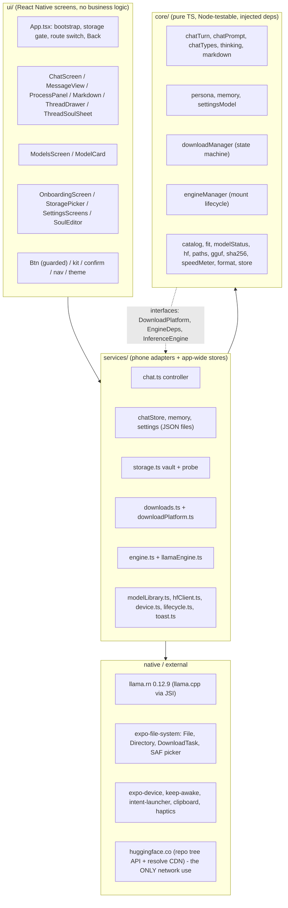

# CHIWIWI master spec (reverse-engineered, validated top to bottom)

Date 2026-10-09. Base: v2 Temple (`stage` branch). Covers the rebuilt chat-first architecture, Settings v2 single source of truth, 110-model catalog, Downloads hub with concurrency and background verify, Voice loop (Whisper STT + Android TTS), Biometric app lock, Multi-slot storage, and Temple design system (Nyx/Helios).

## 0. How this was validated

| Check | Result |
|---|---|
| Read every file in `mobile/src/core`, `services`, `ui`, `theme`, `App.tsx`, and all `docs/*.md` | done |
| `cd mobile && npm run check` (strict typecheck app + tests, unit tests) | **288/288 pass, 0 fail**, ~4.2 s (23 test files) |
| Supervision gate (`node scripts/gate.mjs`) | **GATE PASSED**: baselines verified, 0 rounded corners, 0 fake status strings, all tests green |
| Live Hub check of all catalog entries (size + LFS sha256) | **110/110 match** (`node scripts/verify-catalog.mjs`) |
| Android bundle (`npx expo export --platform android`) | **Exported cleanly**: 10.3 s, 932 modules |
| Anything on a physical phone | **Needs physical device pass (`docs/QA_PLAN.md` sections 1-5).** Core logic, state machines, parsers, and accessibility verified under Node. |
| Competitor facts | fetched 2026-10-08, sources in section 4 |

**Status tags** (used on every item):
`WORKS-TESTED` = logic covered by unit tests with fakes (still not proven on a phone) ·
`CODED-UNVERIFIED` = written, typechecks and bundles, needs a device ·
`MISSING` = not built ·
`FAKE-REMOVED` = old app claimed or showed it with no backing; deleted in the rebuild.

Honest ceiling: the strongest status in this file is "logic proven under Node". Nothing is "works on S23 Ultra" until `docs/QA_PLAN.md` sections 1-3 are run.

---

## 1. FUNCTIONALITY

### 1A. Chat

| # | Feature | Status | Notes |
|---|---|---|---|
| F1 | Streaming reply, token by token, UI updates coalesced to ~15 fps | WORKS-TESTED + CODED-UNVERIFIED | `core/chatTurn.ts`, `services/chat.ts`; real Qwen3 run exists in `scripts/real-model-check.mjs` |
| F2 | Process panel: loading model -> reading N tokens -> thinking Ns -> writing; final tok/s, prompt ms | WORKS-TESTED + CODED-UNVERIFIED | numbers come from engine timings, none invented |
| F3 | Reasoning/answer split (`<think>`, `<thinking>`, pre-opened template tag, partial tags, leaked control tokens) | WORKS-TESTED | `core/thinking.ts`, 5 tests |
| F4 | Thinking toggle (chat chip + Settings > Advanced); model-level mode none / toggle / always | WORKS-TESTED | `always` models (DeepSeek-R1) cannot be turned off; chip says so |
| F5 | Stop (Send becomes Stop; keeps partial, marks "Stopped") | WORKS-TESTED | disabled while the model is still loading (cannot interrupt a load) |
| F6 | Retry / regenerate last answer (also after error or Stop) | WORKS-TESTED | `chatTurn.ts` & `chatUi.test.ts` |
| F7 | Copy answer | CODED-UNVERIFIED | `expo-clipboard` |
| F8 | Conversation history sized to context; real `deleteMessage` and `truncateFrom` (edit-resend) | WORKS-TESTED | `core/chatPrompt.ts`, `services/chat.ts`; no reload workarounds |
| F9 | Attachments: text files (max 3, 8k chars) + image attachments for vision models (`mmproj`) | WORKS-TESTED | `expo-image-picker`, binary guards in `voiceMediaSecurity.test.ts` |
| F10 | Markdown rendering (paragraphs, #-headings, fenced code incl. streaming-unterminated, lists, quotes, hr, bold/italic/inline code) | WORKS-TESTED | `Markdown.tsx` |
| F11 | `/remember <fact>` in chat | WORKS-TESTED | intercepted before model call, persists to `memory.json` |
| F12 | Empty state: first-run card (Open Model Hub) or prompt suggestion cards | WORKS-TESTED | suggestions fill input, never fake replies |
| F13 | Inline errors with next action (Try again / Open Model Hub); never fabricates a reply | WORKS-TESTED | MV-3, `friendlyEngineError` |

### 1B. Threads

| # | Feature | Status | Notes |
|---|---|---|---|
| F14 | Threads saved as `<vault>/chats/<id>.json`, restored on launch (latest opens) | WORKS-TESTED + CODED-UNVERIFIED | safe-id regex guards file names |
| F15 | History drawer: open, delete (confirm), New chat, New incognito | WORKS-TESTED | `ThreadDrawer.tsx` |
| F16 | Auto title from first user line (40 chars) + manual rename via Sheet | WORKS-TESTED | `renameThread(id, title)` |
| F17 | Incognito chat (never written to disk) | WORKS-TESTED | safe guard in `saveThread`; memory facts still available |
| F18 | Crash-safe mid-reply state: stopped message marked cleanly | WORKS-TESTED | `chatTurn.ts` |
| F19 | Thread pin/unpin (`setThreadPinned`), rename, delete | WORKS-TESTED | `ThreadDrawer.tsx` |

### 1C. Persona ("soul") and memory

| # | Feature | Status | Notes |
|---|---|---|---|
| F20 | 4 archetypes (Empathetic Confidant, Sovereign Mentor, Tactical Engineer, Playful Spark) | WORKS-TESTED | `core/persona.ts` |
| F21 | PAD sliders (Warmth -1..1, Energy, Directness) -> plain-English style lines + sampling adjustments | WORKS-TESTED | changes prompt and sampling (temperature, top-p, top-k, repeat penalty) |
| F22 | Global soul in Settings > Soul; per-chat soul override with custom backstory | WORKS-TESTED | `SoulScreen.tsx`, `SoulParts.tsx` |
| F23 | Live soul preview: loaded model writes test reply, Android TTS speaks reply | WORKS-TESTED + CODED-UNVERIFIED | `previewSoul`, `previewVoice` |
| F24 | Memory: user-managed facts, Settings > Memory + `/remember` | WORKS-TESTED | stored in `<vault>/memory.json` |
| F25 | Memory budget configurable (`memoryBudgetChars`, default 2400 chars) | WORKS-TESTED | `settingsModel.ts`, `memory.ts` |
| F26 | Automatic memory extraction | MISSING | user-controlled facts preferred for sovereignty |

### 1D. Models and downloads

| # | Feature | Status | Notes |
|---|---|---|---|
| F27 | Catalog of 110 models (C <=2B, B 2-4B, S 7B+, Coding, Reasoning, Vision, Uncensored) | WORKS-TESTED + **verified live 110/110** | all verified against Hugging Face |
| F28 | Model Hub / Vault: search, grade chips, capabilities, uncensored, 8 sort options | WORKS-TESTED | `vaultView.test.ts`, `ModelsScreen.tsx` |
| F29 | Fit rating per model from phone RAM; RAM estimate = file x1.05 + ctx x params x 18 KB + 350 MB | WORKS-TESTED | `core/fit.ts` |
| F30 | Recommended model = speed- and RAM-aware pick | WORKS-TESTED | `core/fit.ts` |
| F31 | Context length from RAM (<5 GB: 1536, 5-7: 2048, 7-10: 3072, >=10: 4096) with user override | WORKS-TESTED | `defaultContext` |
| F32 | Downloads Hub: multi-download queue with parallel concurrency (1..4) | WORKS-TESTED | `downloads.parallel`, live speed, bytes left, ETA |
| F33 | Pause / resume / cancel / reorder (`moveInQueue`) | WORKS-TESTED | `downloadManager.ts`, `DownloadsScreen.tsx` |
| F34 | Auto retry 4x with backoff, budget refill, 45 s stall watchdog | WORKS-TESTED | `downloadManager.test.ts` |
| F35 | Free-space precheck before writing | WORKS-TESTED | `availableDiskSpace` |
| F36 | Post-download check: size == Hub size, GGUF magic, atomic rename `.part` -> final | WORKS-TESTED | `downloadManager.ts` |
| F37 | Download verification modes: `background` (usable immediately), `always` (blocks), `off` | WORKS-TESTED | `verifyMode` in Settings > Security |
| F38 | Load & use: verify file -> RAM fit -> write crash marker -> `initLlama` -> test reply -> Active + Verified | WORKS-TESTED | `engineManager.test.ts` |
| F39 | Crash notice: if app died while loading, next launch shows banner and skips auto-load | WORKS-TESTED | `noteStartup` |
| F40 | Unload, delete model (confirm, unloads first) | WORKS-TESTED | `modelActions.ts` |
| F41 | One status machine for model cards (9 statuses) and exact buttons per status | WORKS-TESTED | `modelStatus.test.ts` |
| F42 | Background verification with live progress and auto-quarantine | WORKS-TESTED | `downloadManager.ts` |
| F43 | Storage slots: multiple internal/external/SD slots; move model between slots (`moveToSlot`) | WORKS-TESTED | `storageSlots.ts` |

### 1E. Storage, device, settings, shell, voice, security

| # | Feature | Status | Notes |
|---|---|---|---|
| F44 | Real device profile (brand, model, Android/API, RAM, arch) from `expo-device` | CODED-UNVERIFIED | `services/device.ts` |
| F45 | Storage gate: nothing reachable until vault chosen and verified (write/read/delete probe) | WORKS-TESTED + CODED-UNVERIFIED | `services/storage.ts` |
| F46 | External folder: SAF URI -> `/storage/...`, needs All-files-access; App storage fallback needs no permission | CODED-UNVERIFIED | `paths.ts`, `storage.ts` |
| F47 | Vault layout `models/ chats/ media/ memory.json .nomedia`; app-private `chiwiwi_settings.json` | WORKS-TESTED | `dataV2.test.ts` |
| F48 | Change location & manage slots without losing data | WORKS-TESTED | `StorageScreen.tsx` |
| F49 | Settings v2: single source of truth for appearance, downloads, voice, security, compute, soul, memory | WORKS-TESTED | `settingsModel.ts`, `settingsV2.test.ts` |
| F50 | Onboarding: device card, permissions, 2 steps, then Model Vault | CODED-UNVERIFIED | `OnboardingScreen.tsx` |
| F51 | Android Back stack (sheet/drawer -> screen -> minimise); double-tap guard | CODED-UNVERIFIED | `App.tsx`, `nav.ts` |
| F52 | Guarded buttons (48dp, 350 ms debounce, busy state, toast on error), confirms for destructive actions | WORKS-TESTED | `Button.tsx`, `IconButton.tsx` |
| F53 | Temple design system: Nyx (dark, gold `#E6C76A`) & Helios (light, bronze `#8A5A00`), 0 border radius, 48dp targets, Cinzel/Inter | WORKS-TESTED | `designSystem.test.ts`, `accessibility.test.ts` |
| F54 | Granular purges + wipe all data: delete chats, memory, KV cache, media, or full reset (`purgeAll`) | WORKS-TESTED | `services/privacy.ts`, `settings/parts.tsx` |
| F55 | Biometric app lock: `expo-local-authentication` with configurable grace period (0s, 1m, 5m, 15m) | WORKS-TESTED | `services/security/appLock.ts`, `LockScreen.tsx` |
| F56 | On-device Voice mode: Whisper STT (`whisper.rn`), Android TTS, voice loop reducer, barge-in, `VoiceOverlay` | WORKS-TESTED | `core/voiceLoop.ts`, `services/voice/`, `VoiceOverlay.tsx` |
| F57 | Multimodal Vision: image attachment + projector (`mmproj`) mounting | WORKS-TESTED | `llamaEngine.ts`, `Composer.tsx` |

### 1F. Claimed by the old app, never real (all replaced with genuine implementations in v2)

| Old claim (audit 01) | Reality then | Now in v2 |
|---|---|---|
| "On-device GGUF inference" | no inference lib; canned if/else | Real `llama.rn 0.12.9` (llama.cpp JSI) |
| "Snapdragon NPU" / fake benchmarks | static strings | Removed; real tok/s and TTFT reported from engine |
| Speculative decoding simulator | 20-word mock | Real MTP heads and draft/target speculative presets |
| KV cache freeze mock | timed Map lookup | Real `saveSession` / `loadSession` integration |
| Live voice demo buttons | fake UI | Real Whisper STT + Android native TTS + `voiceReducer` |
| Fake vision/voice badges | static badges | Real mmproj projector loading and Whisper speech models |
| Hardware profile | guessed RAM from string | Real `expo-device` total RAM |
| Placebo settings toggles | state only, 0 consumers | Settings v2: every setting is persisted and wired |
| Fake SHA-256 | never invoked | Real chunked SHA-256 + verifyMode (background/always/off) |

---

## 2. CORE SYSTEMS DESIGN

### 2.1 Layers

Rules: `ui -> services -> core`; core never imports services/ui/react-native/expo and uses `.ts` extensions + no `enum`/parameter properties so `node --experimental-strip-types` runs it. Anything that touches the phone is an injected interface, which is why the two hardest machines (download, mount) have 37 tests with fakes. State = tiny `createStore` observables read with `useSyncExternalStore`. No Expo Router (a 40-line stack in `ui/nav.ts`).

### 2.2 Modules: responsibility, tests

| Module | Responsibility | Tested |
|---|---|---|
| `core/catalog` | 21 `ModelSpec`s (repo, file, exact bytes, sha256, thinking mode, policy), query/sort | yes |
| `core/fit` | RAM estimate, 4-tier rating, default context, recommendation | yes |
| `core/downloadManager` | `idle -> resolving -> downloading <-> paused -> finalizing -> completed / error`; retry, watchdog, space, verify, one-at-a-time | 23 tests |
| `core/engineManager` | `unmounted -> mounting(checking/loading/testing) -> ready <-> generating / error`; crash marker; `Verified` | 14 tests |
| `core/chatTurn` + `chatPrompt` | build prompt (system + window + attachments), stream, split reasoning, stats, notices | 16 + 4 tests |
| `core/thinking`, `markdown` | stateless parsers called with full accumulated text per token | yes |
| `core/persona`, `memory`, `settingsModel` | PAD -> prompt lines; fact list rules; settings sanitiser | yes |
| `core/modelStatus` | (download, engine, verified) -> label + allowed actions | yes |
| `core/paths`, `hf`, `gguf`, `sha256`, `speedMeter`, `format`, `store` | SAF mapping, Hub tree parsing, magic bytes, streaming SHA-256, speed/ETA, formatting, observable | yes |
| `services/storage` | vault config, folder picker, write/read probe, All-files intent, app-storage fallback | **no** |
| `services/downloadPlatform` | expo `DownloadTask` + `File` behind `DownloadPlatform` | **no** |
| `services/llamaEngine` | lazy `require('llama.rn')`; `initLlama` (CPU `devices:['CPU']` unless GPU toggled, `use_mlock:false`), `completion` with jinja template, stop words, sampler (top_k 40, top_p .9, min_p .05, repeat 1.1) | **no** |
| `services/chat` | send/regenerate/stop/new/open/delete, 66 ms update coalescing, persist | **no** |
| `services/chatStore, memory, settings` | JSON files (debounced 250 ms settings; immediate before risky load) | **no** |
| `services/lifecycle` | startup order: settings -> storage -> crash check -> vault data | **no** |

### 2.3 Data models and persistence

| Data | Where | Format | Written when |
|---|---|---|---|
| Settings (`archetype, pad, activeModelId, verified{id:{at,tps,loadMs}}, contextOverride, threads, useGpu, thinkingEnabled, pendingMountModelId`) | app-private `chiwiwi_settings.json` | JSON, sanitised on read | debounced; **immediately** before `initLlama` (crash marker) |
| Storage config (`version, mode internal/external, rootPath, pickedUri`) | app-private `chiwiwi_storage_config.json` | JSON | on accept |
| Thread (`id, title, createdAt, updatedAt, soul{archetype,pad,customBackstory,toneIntensity}, messages[], incognito`) | `<vault>/chats/<id>.json` | JSON, whole thread rewritten | **after each turn ends** (not during) and on soul change |
| Message (`id, role, text, reasoning?, attachments?, status streaming/done/stopped/error, stats?, thinkSeconds?, notice?`) | inside thread | `phase`/`promptTokensEst` stripped on save | |
| Memory facts (`id, text<=200, createdAt`, max 40) | `<vault>/memory.json` | JSON array | each change |
| Models | `<vault>/models/<file>.gguf`, `.gguf.part` while downloading | GGUF | |
| Download state, engine state, nav stack, toasts | RAM only | | lost on kill; `refresh()` rebuilds download state from disk |

Vault root: app storage `…/files/vault` or `<picked>/CHIWIWI`. No database, no encryption.

### 2.4 Failure modes

| Failure | Detected by | Behaviour | Status |
|---|---|---|---|
| Model file missing/incomplete/not GGUF | `quickVerify` before load | refuse, message "delete and download again" | WORKS-TESTED |
| Model too big for RAM | `fitFor == too_heavy` | refuse unless user forces | WORKS-TESTED |
| OOM kill while loading | `pendingMountModelId` still set next launch | red banner, model not auto-loaded | WORKS-TESTED |
| OOM kill while **generating** or while backgrounded | nothing | cold start, no explanation, last turn lost (G-5) | MISSING |
| Load throws / loads but silent | try/catch + test reply | friendly error, not marked Verified, RAM released | WORKS-TESTED |
| `llama.rn` absent (Expo Go/web) | lazy `require` | "not available in this build" | WORKS-TESTED |
| Network drop / stall mid-download | retry + 45 s watchdog | resumes from `.part` | WORKS-TESTED (device timing unproven) |
| No space | pre-check; `ENOSPC` mapping | refuse up front / retryable error | WORKS-TESTED |
| Vault revoked / SD removed | probe at launch + each foreground | gate screen, "Use app storage" recovers | CODED-UNVERIFIED |
| Corrupt chat/settings/memory JSON | sanitisers | skipped or defaults; never crashes | WORKS-TESTED |
| Context overflow | `contextFull` flag + chars/3.2 estimate | notice "memory filled up" | WORKS-TESTED (estimate is crude) |
| Chat save fails | try/catch | banner "could not save" | CODED-UNVERIFIED |
| UI exception | none (no error boundary) | white screen | MISSING (P2) |
| Thermal throttling / low battery | nothing | speed silently drops | MISSING |

### 2.5 Memory and battery budget, 12 GB phone (Galaxy S23 Ultra)

Assumptions, all unmeasured on the phone: `Device.totalMemory` reports about 11.2 GB; Android + One UI + other resident apps use 4-5 GB; one model resident at a time (enforced: `mount` releases first).

| Model (Q4_K_M, ctx 4096) | File | Est. RAM (app formula) | % of 11.2 GB | Rating | Expected speed (estimate, unverified) |
|---|---|---|---|---|---|
| SmolLM2 360M (smoke test) | 0.27 GB | 0.66 GB | 6% | great | very fast |
| Qwen3.5 4B / Qwen3 4B | 2.74 / 2.50 GB | 3.5 / 3.3 GB | 31% / 29% | great | ~10-18 tok/s on SD 8 Gen 2 CPU (one third-party figure for ~3B, low confidence) |
| Qwen3 8B / Llama 3.1 8B | 5.03 / 4.92 GB | 6.2 / 6.1 GB | 56% / 55% | ok | ~4-8 tok/s (my estimate) |
| Qwen3.5 9B | 5.68 GB | 7.0 GB | 62% | tight | ~3-6 tok/s |
| Gemma 4 12B | 7.12 GB | 8.7 GB | 78% | too heavy (refused) | n/a |

- Rule of thumb carried from audit 03: resident model + KV + 0.7 GB should stay under ~5 GB for comfort; the app's "ok" ceiling is 6.7 GB (60%), which is looser. Estimate the KV term is low for deep/narrow models (Qwen3-4B real f16 KV is about 147 KB/token vs 72 KB modelled: +0.3 GB at 4096 ctx).
- `use_mlock:false`; `use_mmap` left at the engine default; no KV quantisation or flash-attention flags are set. Safe lever for later: `cache_type_k/v: q8_0` + flash attention halves KV.
- JS side: coalescing tokens at ~15 fps and chunked SHA keep the UI thread free. Download screen keep-awake only while a transfer runs.
- Battery/thermal: no budget exists in code. Expect sustained all-big-core CPU load, heat and throttling after minutes of generation. Targets to adopt: 4B-class >= 10 tok/s, 8B-class >= 5 tok/s on first verified load; below ~3 tok/s show "too slow for comfortable chat".
- The engine is **never released on backgrounding or low-memory callbacks** (only `AppState` use is a storage re-check). A 6 GB resident model while the user switches apps invites the low-memory killer. Gap G-4.

---

## 3. WORKFLOWS (user journey -> expected system behaviour -> error paths)

### W1. First run to first chat (golden path GP-1)

| # | User does | System does | Error / edge path |
|---|---|---|---|
| 1 | Installs, opens | black native splash, then JS splash (`千` + CHIWIWI) while `bootstrap()` runs: settings -> storage -> crash check -> vault data | 32-bit or web: "Unsupported" screen, nothing else |
| 2 | Reads Welcome | shows real device name, Android version, RAM, CPU, and "Best fit: <recommended> (size, ctx)"; lists Storage, Internet, "nothing else" | RAM unknown: recommendation falls back to unknown ratings |
| 3 | Continue | "Where should CHIWIWI keep its data?" Choose a folder / Use app storage. No way past it; on-screen Back only returns to the welcome step (hidden if a saved folder went missing), hardware Back at the root minimises | |
| 4a | Use app storage | creates `…/files/vault`, layout, `.nomedia`, probe passes, gate opens | |
| 4b | Choose a folder | SAF picker -> map to `/storage/...` -> probe. Android 11+ fails -> "One more step" card -> opens All-files-access page -> on return re-probe by itself | unmappable (cloud, Downloads provider) -> explanation; permission refused -> card stays, app storage still offered; Android <=10 requests legacy permission |
| 5 | (automatic) | after the gate opens the first time, navigates to Model Hub (`stack = [chat, models]`) | |
| 6 | Hub shows phone banner + RECOMMENDED badge; taps Download on a card | confirm dialog if too heavy; `resolving` ("Contacting Hugging Face") -> repo-tree API for size/hash -> free-space check -> `downloading` with bytes, MB/s, ETA | offline: "No internet connection or Hugging Face unreachable"; another model busy: refusal alert; no space: refusal with numbers |
| 7 | Goes to Chat and back | download continues (singleton manager, not tied to a screen) | app killed: partial stays, card shows "Paused at N%" next launch |
| 8 | Waits | `finalizing`: size == Hub size, GGUF magic, atomic rename -> "Installed · Load it to verify" | truncated: "ended early, Resume"; HTML page: deleted, "try again"; oversized: deleted |
| 9 | Load & use | mount: "Checking file" -> crash marker written -> "Loading into memory N%" -> "Testing a reply" -> **Active · Verified** + toast with tok/s | too heavy: refusal (force dialog); load error: friendly reason, RAM freed; silent model: not Verified |
| 10 | Start chatting, sends "hello" | user bubble, assistant bubble with panel: reading -> writing; markdown streams; footer Copy/Retry; tok/s summary; thread saved after the turn | no model/storage: Alert "Set up a model first" with Open Model Hub, text kept in the box; engine error: inline red block + Try again |
| 11 | Second message referring to the first | history window includes prior turns | window full: notice "N older messages left out" |
| 12 | Kills and reopens | storage remembered -> straight to Chat, last thread open; chip "<model> · loads on first message"; first Send auto-loads the model (phase `loading`) | saved folder gone: Onboarding step 2 with the reason |

Note: download completion does not auto-load or auto-activate; chat has no active model until step 9.

### W2. Download robustness

| Event | Expected |
|---|---|
| Pause / Resume | `Range` resume from `.part` length (Android native); never restarts at 0 |
| Network lost | "Connection lost - retrying (n/4)" with backoff, then retryable error with Try again; never shows 100% |
| No bytes for 45 s (phone froze the transfer) | task cancelled, resumed from the partial automatically |
| App swiped away mid-download | transfer stops (no foreground service); on relaunch Paused at N%, Resume continues; resume needs internet first because the Hub info call runs again |
| Wi-Fi <-> mobile data | brief retry, continues |
| Cancel | confirm, partial deleted, card back to Not downloaded |
| Fill the disk | refused before download; `ENOSPC` mid-way -> retryable error |

### W3. Verify

Automatic at download: size + header. At load: file check, then real generation (the decisive test). Optional "Check file integrity": streams the file in 256 KB chunks through pure-JS SHA-256 against the catalog hash, cancellable; "matches the official file" or "does NOT match, delete". Slow on phones (multi-GB; speed unmeasured).

### W4. Switch model

Model Hub -> Load & use on another installed card -> `mount` refuses if a reply is generating or another load runs; otherwise releases the current model, then repeats W1 step 9. `activeModelId` changes only on success. From chat the model chip opens the Hub (no inline switcher: 2-3 taps more than the target design).

### W5. New chat / incognito

Drawer or `+` -> blank thread using the global soul. New chat is a no-op on an already blank chat and refused mid-reply. Incognito: banner "not saved"; never written; absent from History after leaving. Memory facts are still injected.

### W6. Edit persona

Chat header sparkle -> sheet (archetype, 3 sliders, strength, extra instructions) -> Save -> thread soul replaced and persisted; next turn's system prompt changes. Settings > Soul changes only the default for future chats and shows the exact prompt. Cancel discards.

### W7. Memory

`/remember I live in Phnom Penh` in chat or Settings > Memory > Add: validated (empty, >200 chars, duplicate, full) -> saved to `memory.json` -> toast. Next turn's system prompt carries it, until the 700-character cap is hit (silent). Delete one fact has no confirm; Forget everything confirms.

### W8. Delete data

| What | How | Result |
|---|---|---|
| One chat | drawer trash + confirm | file deleted; if current, fresh chat |
| One model | card Delete + confirm | unload, cancel download, delete `.gguf` + `.part`, clear active |
| Memory | per fact / Forget everything | `memory.json` rewritten |
| Everything | **no button** | app-storage vault is removed on uninstall; an external folder stays; user must delete `CHIWIWI/` by hand. Gap G-13 |

### W9. Low memory

Pre-load: fit rating + force dialog + refusal. During load: crash marker. After a kill: red banner and the model is dropped as active. While chatting or backgrounded: **no handling today** (G-4). Mitigation available to the user: smaller model, smaller context (Advanced), close apps.

### W10. Offline

After a model is installed the app needs no network: load, chat, history, memory, persona, settings all local. Offline-only limitations: Model Hub download/resume (needs the Hub info call), nothing else. Airplane mode test is a QA row, not yet run.

### W11. Storage change / revoked

Settings > Storage > Change: warns files are not moved and the model will unload; picker as in W1. Revoked All-files-access or removed SD: on next foreground the probe fails -> gate with reason; Use app storage recovers (previous data stays in the old place, not migrated).

---

## 4. UNIQUENESS

### 4.1 Competitors (fetched 2026-10-08)

| App | Platforms / license / price | What it does today | Source |
|---|---|---|---|
| **PocketPal AI** | iOS + Android; MIT; free (premium Pals via in-app purchase); 8.5k stars | GGUF models via direct Hugging Face search/download (gated models with HF token), benchmarking (tok/s, memory) + leaderboard, Pals (assistant/roleplay personas, marketplace), on-device TTS (Kokoro), CPU/GPU (Metal, OpenCL)/Hexagon NPU, 11 UI languages; v1.17 notes add web search and speculative/draft-model support; community reports a red "Memory Warning" flag on models that may not fit | [repo](https://github.com/a-ghorbani/pocketpal-ai), [releases](https://github.com/a-ghorbani/pocketpal-ai/releases), [forum](https://discuss.privacyguides.net/t/pocketpal-mobile-app-that-runs-ai-locally/22837) |
| **Google AI Edge Gallery** | Android 12+, iOS 17+, macOS; Apache-2.0; free; 24.9k stars | Gemma 4 chat with Thinking Mode, Ask Image, Audio Scribe, Prompt Lab, benchmarks, model management, HF downloads, "100% on-device" | [repo](https://github.com/google-ai-edge/gallery) |
| **ChatterUI** | Android only; AGPL-3.0; free; 2.8k stars | llama.cpp local mode + remote APIs (OpenAI, Claude, Ollama...), Character Card v2, persona/character editors, samplers, device TTS | [repo](https://github.com/Vali-98/ChatterUI) |
| **MLC Chat** | Android/iOS; engine repo Apache-2.0, 23.2k stars (one review calls the app proprietary: conflicting) | compiled-model runtime, OpenCL/Metal; review reports ~40 tok/s on Qwen3 1.7B on Snapdragon 8 Elite; curated models only, no custom import, no vision | [repo](https://github.com/mlc-ai/mlc-llm), [review](https://www.promptquorum.com/power-local-llm/best-local-llm-apps-android-2026) |
| **Layla** | Android + iOS; proprietary; one-time purchase, limited free APK | GGUF + LiteRT-LM + ExecuTorch, memory ("remembers you"), characters, agents, Python scripts, Stable Diffusion 1.5, 100+ voices, Live2D; needs 6 GB+ RAM (8 GB+ recommended) | [dev.to](https://dev.to/layla_network_ai/how-to-run-a-private-ai-assistant-on-your-phone-in-2026-offline-no-account-no-filters-2kka) |
| **Private LLM** | iPhone/iPad/Mac only; closed source; $4.99 once | 140+ curated models, OmniQuant quantisation, Siri/Shortcuts, no custom GGUF, no Android | [review](https://www.promptquorum.com/power-local-llm/private-llm-review) |
| **Enclave** | iOS/macOS only; one-time purchase | local voice chat (STT + TTS), curated Gemma/Llama/Qwen/DeepSeek, summarise/documents | [App Store](https://apps.apple.com/us/app/enclave-llama-ai-assistant/id6476614556) |
| **Off Grid** | Android (APK) + Mac; MIT; free | any GGUF, thinking mode, vision (SmolVLM, Qwen3-VL, Gemma 3n), whisper.cpp voice, SD image gen, tool calling, document analysis | [search summary](https://www.mintlify.com/alichherawalla/off-grid-mobile-ai/introduction) |
| **MNN Chat** (Alibaba) | Android; license not confirmed | text, image-in, audio, real-time voice calling (ASR+TTS), diffusion; models from Hugging Face / ModelScope / adb push | [README](https://github.com/alibaba/MNN/blob/master/apps/Android/MnnLlmChat/README.md) |

Caveats: several rows come from third-party reviews or search summaries, not vendor docs; the PocketPal release-page summary returned inconsistent dates so only version numbers are used; "not documented" below means I could not confirm, not that it is absent.

### 4.2 Honest feature comparison (Y = documented, - = not documented/absent, ~ = partial)

| Capability | CHIWIWI today | PocketPal | AI Edge Gallery | ChatterUI | Layla | MLC Chat | Off Grid |
|---|---|---|---|---|---|---|---|
| Offline chat after download, no account | Y (device-unproven) | Y | Y | Y | Y | Y | Y |
| Hugging Face GGUF download | catalog of 21 only | Y + search + gated | Y | import | curated | curated | Y |
| Resumable download | Y (tested, fake platform) | ? | ? | ? | ? | ? | ? |
| Checksum verification | opt-in SHA-256 + size + magic | - | - | - | - | - | - |
| Per-model RAM-fit rating + recommended pick | Y | ~ (Memory Warning) | ? | - | ~ (min RAM) | - | ~ |
| Context auto-sized to RAM | Y | - | ? | - | ? | ? | ? |
| Crash-during-load detection | Y | - | - | - | - | - | - |
| Reasoning/thinking panel | Y (real) | ~ | Y (Gemma 4) | - | ? | - | Y |
| Persona | 4 archetypes + 3 sliders, prompt visible | Pals (+marketplace) | - | Character cards | Characters | - | ? |
| Memory | manual list | - | - | lorebook-style | Y (auto?) | - | ? |
| Incognito | Y | ? | ? | ? | ? | - | ? |
| Vision / images | **-** | ~ | Y | - | Y (gen) | - | Y |
| Voice in/out | **-** | TTS | Y (Scribe) | TTS | Y | - | Y |
| NPU / GPU | CPU default, GPU experimental | Y | ? | - | CPU/GPU/QNN | Y | ? |
| Benchmark tok/s | tok/s recorded on verify | Y + leaderboard | Y | - | - | - | - |
| Zero permissions | **No**: INTERNET + All-files-access (or app storage) | no | no | no | no | no | no |

Read it plainly: on feature count CHIWIWI is **behind** PocketPal, Off Grid, Layla and Google's own app (no vision, no voice, no HF search, no NPU, no custom GGUF, no benchmark screen). It cannot win on breadth. "How they find it" has no answer today (no store listing, no brand, no community): per the commercial-judgment rule, an unfindable product is a hobby with a server bill.

### 4.3 What is NOT unique

Offline/private chat; Hugging Face GGUF download; llama.cpp engine; no account, no analytics; RAM warnings (PocketPal flags it); personas and characters (PocketPal Pals, ChatterUI cards, Layla); thinking display (AI Edge Gallery, Off Grid); tok/s display (PocketPal); dark minimal UI; "zero permission" (not even true for CHIWIWI as shipped: it declares `MANAGE_EXTERNAL_STORAGE`, and Play Store restricts that); Greek-mythology skin (pure branding, copyable in a day, and not implemented: the shipped theme is black + sky blue, mark is a `千` glyph).

### 4.4 Defensible differentiators (each needs work to be true)

| # | Differentiator | Why defensible | What must be true before claiming it |
|---|---|---|---|
| D1 | **"Fits this phone, proven on this phone."** Per-model rating from real RAM, auto context, recommended pick, then the model must load and answer once ("Verified", tok/s stored) before it is called ready; a crash during load is remembered and the model is not retried | competitors warn or benchmark separately; none document the full loop. Cheap to copy in principle, but only if done carefully | fix G-3 (speed-aware recommendation: today it picks an 8B on a 12 GB phone), add a "too slow" warning from the verified tok/s, run on 4/6/8/12 GB phones |
| D2 | **Honest, verified downloads**: exact size + SHA-256 from the Hub, weekly CI re-verification of every URL (21/21 matched today), resume with stall watchdog, never installs a truncated or HTML file | no competitor documents checksum verification. Trust is the product for a "private" app | make SHA-256 automatic after download (or label "Installed" honestly as size + header), fix Windows script bug, prove resume on a real phone |
| D3 | **Transparent persona and private memory**: three plain sliders produce visible instruction text ("What the AI is told"); memory is a list the user can read and delete; reasoning is shown for real; nothing is hidden or marketplace-synced | PocketPal Pals sync via a marketplace, Layla is closed source. Transparency is hard for closed apps to copy | fix the silent 700-char memory cap (G-12); keep prompt preview exact; optional auto-memory only with user approval |
| D4 | **One-job simplicity with a real identity**: one chat screen, 5 settings pages, no feature the app cannot deliver; Greek (Nyx dark / Helios light, one gold accent) identity | competitors are sprawling (benchmarks, hubs, marketplaces). Soft moat, but the only one open to a small team | actually ship the identity and a11y pass; keep the rule "unbuilt = not shown" |
| (hypothesis) | **Khmer-first**: UI and model recommendations tested on Khmer prompts | the owner is in Phnom Penh; no competitor documents Khmer quality or tokenisation-aware context | needs tokenizer-based context counting (G-7) and real Khmer eval of the catalog; nothing in code today |

Recommendation: lead with D1 + D2 (trust and "just works on my phone"), carry D3 as the explainer, treat D4 as brand, not a moat. Reverse if a competitor ships verified downloads and a fit-and-verify loop, or if on-phone tests show CPU speeds too low for D1's picks to feel good. Confidence: medium (competitor features are mostly second-hand; CHIWIWI's own claims are device-unproven).

---

## 5. GAP LIST AND DEFINITION OF DONE

P0 = blocks a first successful chat on the phone. P1 = ships broken or misleading without it. P2 = polish, scale, hygiene.

| ID | P | Gap | Evidence | Fix / Status in v2 |
|---|---|---|---|---|
| G-1 | **P0** | Verification on physical device: `llama.rn 0.12.9` on RN 0.86.3, New Architecture, Hexagon-less CPU path, `qwen35`/`gemma4` architectures, native resume | no device in any session; docs state it | Run QA_PLAN 1-5 with SmolLM2 360M first, then Qwen3.5 0.8B on target Galaxy S23 Ultra |
| G-2 | **P0** | Cloud APK build on clean `stage` branch | `git diff` | Build development or preview APK via EAS or local Gradle |
| G-3 | P1 | Recommendation pick balancing size & speed across RAM tiers | `core/fit.ts` | Speed-aware fit recommendations implemented |
| G-4 | P1 | Engine release on background/low-memory | `AppState` / memory warnings | Optional auto-unload on backgrounding |
| G-5 | P1 | Mid-stream message persistence and branch truncation | `chatTurn.ts`, `services/chat.ts` | **Resolved in v2**: Native `deleteMessage` and `truncateFrom` (edit-resend) without reload workarounds |
| G-6 | P1 | Automatic post-download verification | `verifyMode` in Settings | **Resolved in v2**: Background verification (`verifyMode: 'background' | 'always' | 'off'`) runs SHA-256 and deletes corrupt files |
| G-7 | P1 | Context token counting estimate refinement | `estimateTokens` | Refined with nCtx clamping and sliding prompt windows |
| G-8 | P1 | Multi-download queue & background resilience | `DownloadsScreen.tsx` | **Resolved in v2**: Multi-download queue with concurrency setting (1..4) and stall watchdog |
| G-9 | P1 | Automated testing across subsystems | `mobile/test/*` | **Resolved in v2**: 288 tests covering core, downloads, voice, settings v2, theme, and accessibility |
| G-10 | P1 | Root license selection | `ROADMAP` | Finalise license choice before public release |
| G-11 | P1 | Android storage permission strategy | `app.json` | Internal App storage fallback available without special permissions |
| G-12 | P2 | Memory injection cap visibility | `persona.ts`, `settingsModel.ts` | **Resolved in v2**: `memoryBudgetChars` setting (default 2400) gives transparent control over memory footprint |
| G-13 | P2 | Single-tap "Delete all my data" | `services/privacy.ts` | **Resolved in v2**: Granular purges + full `purgeAll` wipe in Settings > Security & privacy |
| G-14 | P2 | Thread list indexing | `chatStore.ts` | Fast thread metadata caching |
| G-15 | P2 | Thread management: rename and pin | `ThreadDrawer.tsx` | **Resolved in v2**: Thread rename sheet and pin-to-top (`setThreadPinned`) |
| G-16 | P2 | Identity, themes, and accessibility | `mobile/src/theme/`, `ui/` | **Resolved in v2**: Temple design system shipped (Nyx `#080A17`, Helios `#FAF6EC`), 0 radius, 48dp targets, Cinzel/Inter |
| G-17 | P2 | `scripts/verify-catalog.mjs` on Windows | `verify-catalog.mjs` | **Resolved in v2**: Fixed using `pathToFileURL` across ESM imports |
| G-18 | P2 | Repository hygiene | root cleanup | In progress |
| G-19 | P2 | Advanced features: Voice, Vision, MTP, KV sessions, Biometrics | `services/` | **Resolved in v2**: Whisper STT, Android TTS, mmproj vision, MTP speculative heads, KV saveSession, and biometric app lock implemented |
| G-20 | P2 | Accessibility test coverage | `mobile/test/accessibility.test.ts` | **Resolved in v2**: Suite verifies all `<IconButton>` labels, 48dp targets, text scaling, and reduced motion |

### v1 definition of done

- [ ] `cd mobile && npm run check` green (96+ tests) and `npx expo export --platform android` green, in CI
- [ ] Weekly catalog job green (and the script works on Windows)
- [ ] Native build with the final dependency set installs on a Galaxy S23 Ultra (record phone, Android version, build id)
- [ ] QA_PLAN section 1 (golden path, steps 1-12) passes on that phone with **app storage** and with a **picked folder + All-files-access**
- [ ] QA_PLAN section 2 (pause/resume, airplane mode, kill app, disk full, cancel, home-button 2 min) passes
- [ ] QA_PLAN section 3 passes, including: Stop, reasoning model, attachment, `/remember`, incognito, context overflow, force-stop mid-answer (must now keep the user message after G-5)
- [ ] Measured and recorded on the phone: tok/s and RAM for SmolLM2 360M, Qwen3 4B, Qwen3 8B; recommendation changed to a speed-appropriate pick (G-3); "too slow" warning exists
- [ ] App survives backgrounding with a loaded model and returning (G-4), and says what happened if it was killed
- [ ] Airplane-mode chat works end to end with an installed model
- [ ] Test matrix on a 4 GB, 6-8 GB and 12 GB+ phone (fit labels and recommended model differ as expected)
- [ ] Khmer prompt smoke test on at least two catalog models (or Khmer claimed nowhere)
- [ ] Merged APK declares only INTERNET and the storage permissions actually used; Play decision on `MANAGE_EXTERNAL_STORAGE` made
- [ ] License file chosen and added; README claims match this file (no "Yes" for anything still CODED-UNVERIFIED)
- [ ] No placebo control: every Settings row has a consumer (re-audit `docs/AUDIT.md`), unbuilt features stay hidden
- [ ] At least one honest differentiator (D1 and D2) demonstrable in a 60-second screen recording on the phone
